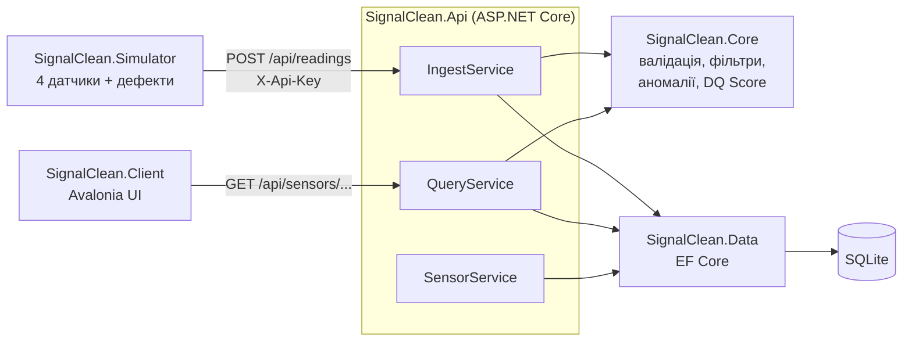

# SignalClean — платформа оцінювання якості та очищення сенсорних даних

**Мультиплатформна програмна платформа оцінювання якості та очищення сенсорних даних**

Курс: Мультиплатформне програмування (МП).

## Про проєкт

Дані з реальних датчиків рідко бувають чистими: шум, пропуски, викиди, значення-«коди помилок» (−999), NaN, «залиплі» показники, розриви в передаванні. SignalClean приймає потоки вимірювань від мережі датчиків (у проєкті її імітує симулятор) і:

- **перевіряє** кожне значення: пропуск, NaN/∞, фізичний діапазон типу датчика, коректність часу;
- **очищає** сигнал: сплески замінюються медіаною попередніх значень (каузальний фільтр Гампеля, оцінка розкиду через MAD);
- **виявляє аномалії**: сплеск, вихід за діапазон, NaN, «залипання», розрив у даних, некоректний час;
- **рахує індекс якості даних** (Data Quality Score, 0–100, класи A–D) за повнотою, достовірністю та часткою аномалій;
- **показує** живі дані, графік «сирий / очищений» сигнал, метрики та журнал аномалій у десктоп-клієнті.

Усі компоненти працюють на **Windows, Linux і macOS**.

## Архітектура



| Проєкт | Призначення | Технології |
|---|---|---|
| `src/SignalClean.Core` | Доменна логіка: валідація, фільтри, детектор аномалій, індекс якості, DTO | .NET 10, без залежностей |
| `src/SignalClean.Data` | Схема БД (3НФ), DbContext, початкові дані | EF Core 10, SQLite |
| `src/SignalClean.Api` | REST API, прийом пакетів у транзакції, захист API-ключем | ASP.NET Core 10 |
| `src/SignalClean.Simulator` | Імітація мережі з 4 датчиків з дефектами | .NET 10 console |
| `src/SignalClean.Client` | Мультиплатформний дашборд | Avalonia UI 11 |
| `tests/SignalClean.Core.Tests` | Модульні тести доменної логіки | xUnit, coverlet |
| `tests/SignalClean.Api.Tests` | Інтеграційні тести API | xUnit, WebApplicationFactory |

## Команда та зони відповідальності

| Учасник | Зона відповідальності |
|---|---|
| **Поліна Онипчук** (@jewrlly) | Backend: схема БД і `SignalClean.Data`, REST API, прийом пакетів у транзакції, API-ключ, інтеграційні тести API |
| **Катерина Павленко** (@katepvlnk) | Клієнт `SignalClean.Client`: MVVM, дашборд, власний компонент графіка, обробка недоступності API |
| **Артем Семенюк** (@Bio5648) | Оброблення даних `SignalClean.Core`: валідація, фільтри, детектор аномалій, індекс якості, модульні тести; симулятор; CI |

## Запуск

### Вимоги
- [.NET 10 SDK](https://dotnet.microsoft.com/download/dotnet/10.0)
- Git
- Більше нічого: база SQLite створюється автоматично під час першого запуску API.

### Кроки (Windows / Linux / macOS)

```bash
git clone https://github.com/jewrlly/SignalClean.git
cd SignalClean
dotnet build
```

Далі в **трьох окремих терміналах** з кореня репозиторію:

```bash
# 1. API (http://localhost:5080)
dotnet run --project src/SignalClean.Api

# 2. Симулятор датчиків
dotnet run --project src/SignalClean.Simulator

# 3. Клієнт
dotnet run --project src/SignalClean.Client
```

У клієнті одразу з'являться 4 датчики; через кілька секунд з'являться графік, метрики та аномалії.

Параметри симулятора:

| Параметр | Значення за замовчуванням | Опис |
|---|---|---|
| `--api` | `http://localhost:5080` | адреса API |
| `--key` | `dev-key-change-me` | API-ключ (має збігатися з `Ingest:ApiKey` у `appsettings.json`) |
| `--interval` | `1000` | період надсилання, мс (мінімум 100) |
| `--seed` | випадковий | зерно генератора, щоб повторити сценарій |
| `--clean` | вимкнено | надсилати дані без дефектів |

Приклад: `dotnet run --project src/SignalClean.Simulator -- --interval 500 --seed 42`

### Тести та покриття

```bash
dotnet test --collect:"XPlat Code Coverage" --results-directory ./coverage
```

Звіт про покриття формує CI: вкладка **Actions** → останній запуск → артефакт `coverage-report`.

### Ручна перевірка API

Файл `src/SignalClean.Api/SignalClean.Api.http` містить готові запити. Їх можна виконати у Visual Studio або у VS Code з розширенням REST Client.

## API

| Метод | Шлях | Опис |
|---|---|---|
| GET | `/health` | перевірка працездатності |
| GET | `/api/sensors` | датчики з поточним індексом якості |
| GET | `/api/sensors/{code}` | один датчик |
| POST | `/api/sensors` 🔑 | створити датчик |
| POST | `/api/readings` 🔑 | пакет вимірювань (до 1000) |
| GET | `/api/sensors/{code}/readings?limit=100` | останні вимірювання (сире + очищене значення, статус) |
| GET | `/api/sensors/{code}/anomalies?limit=50` | останні аномалії |
| GET | `/api/sensors/{code}/quality?window=200` | звіт про якість даних |

🔑 — потрібен заголовок `X-Api-Key`.

## Процес роботи

- Кожна задача — це Issue. Під неї створюється гілка `feature/<номер>-<коротка-назва>`.
- У `main` код потрапляє лише через Pull Request з рев'ю іншого учасника; CI має бути зеленим.
- Коміти посилаються на Issue (`#12 ...`), PR закриває Issue (`Closes #12`).
- Ключові рішення записані в [`docs/decisions.md`](docs/decisions.md).
- Тест-кейси: [`docs/test-cases.md`](docs/test-cases.md); крайні випадки: [`docs/edge-cases.md`](docs/edge-cases.md); цілісність даних: [`docs/data-integrity.md`](docs/data-integrity.md).